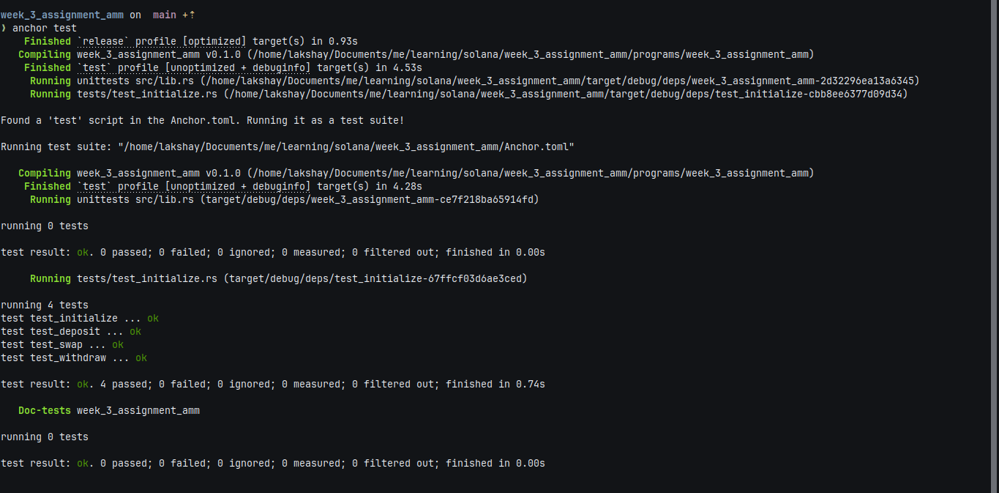

# Solana Anchor AMM (Constant Product Market Maker)

An on-chain Solana Automated Market Maker (AMM) program built with the Anchor
framework, SPL Token program, and Constant Product Curve model. This project
implements a decentralized exchange supporting the full liquidity and trading
lifecycle: **`initialize`**, **`deposit`**, **`swap`**, and **`withdraw`**, complete
with configurable trading fees, protocol treasury collection, and slippage
protection using Program Derived Addresses (PDAs) and Token CPIs with PDA signing.

---

## Assignment Overview

The assignment requirements:
> **1. Write the AMM program.**
> **2. Add fees and treasury account**
> **3. Write tests covering all the instructions.**

- **`initialize`**: Initializes the `PoolConfig` PDA state account, an `LP Mint`
  PDA (`[b"lp", pool_config]`), and associated token vaults (`vault_x`, `vault_y`)
  owned by the pool config PDA. Configures swap fees (`fee`), treasury fee share
  (`treasury_fee`), pool authority, and the designated protocol `treasury` account.
- **`deposit`**: Allows liquidity providers to deposit pairs of Token X and Token
  Y into the pool in exchange for newly minted LP tokens. Supports initial liquidity
  bootstrapping as well as subsequent deposits calculated proportionally via
  constant-product curve math (`ConstantProduct::xy_deposit_amounts_from_l`) with
  slippage protection (`max_x`, `max_y`).
- **`swap`**: Executes two-way token swaps using the constant product formula.
  Deducts the configured trading fee, routes the protocol fee share (`treasury_fee`)
  directly to the protocol's treasury token account, deposits the remaining input
  amount into the pool vault (accruing yield to LPs), enforces slippage limits
  (`min_amount_out`), and transfers output tokens from the vault to the swapper
  via PDA signing.
- **`withdraw`**: Allows liquidity providers to redeem their liquidity by burning
  LP tokens. Computes proportional withdrawal amounts of Token X and Token Y using
  `ConstantProduct::xy_withdraw_amounts_from_l`, verifies minimum return thresholds
  (`min_x`, `min_y`), and releases tokens from vaults back to the user via PDA signing.

---

## Prerequisites

- **Rust**: 1.80+ / 1.98+
- **Solana CLI**: 1.18+ / 2.0+
- **Anchor CLI**: 0.30+ / 1.1+

---

## Setup

Ensure your local keypair exists:

```bash
solana-keygen new --outfile ~/.config/solana/id.json
```

---

## Build & Test

Tests use **LiteSVM** for fast in-process VM execution without running a local validator.

### 1. Build the Program

Compile the Solana program into SBF bytecode (`target/deploy/week_3_assignment_amm.so`):

```bash
anchor build
```

> **Note:** `anchor build` must be run before tests because `test_initialize.rs`
> embeds `week_3_assignment_amm.so` at compile time via `include_bytes!`.

### 2. Run Tests

Execute the Rust test suite using LiteSVM:

```bash
cargo test
```

*(or run `anchor test`)*

### 3. Test Results

Screenshot showing all tests passing:


